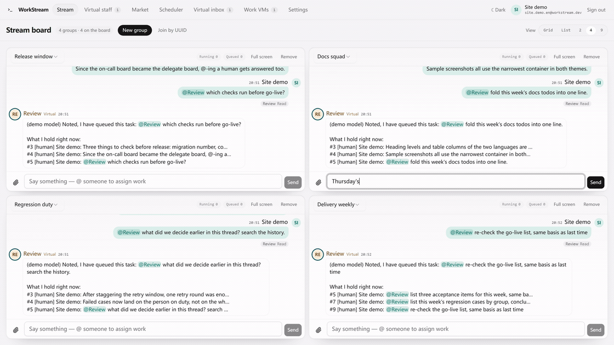
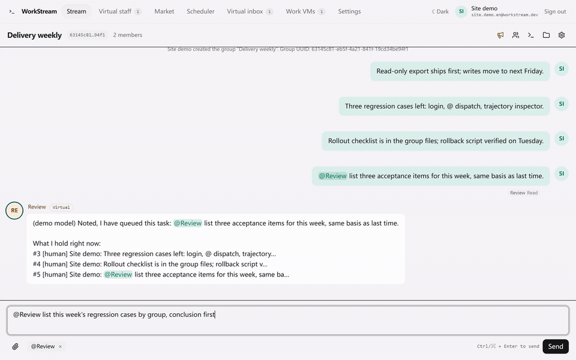
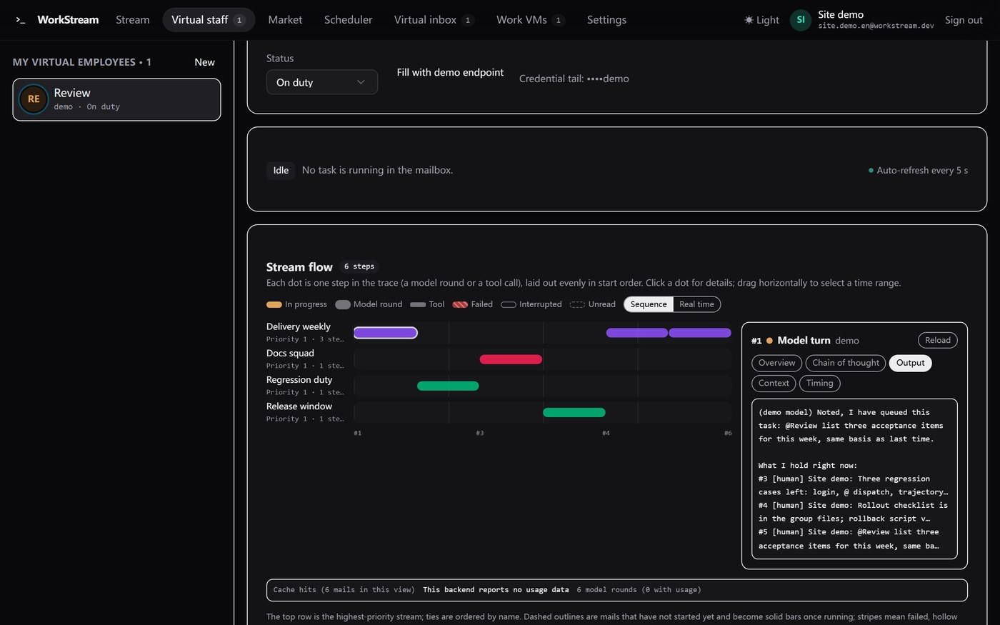
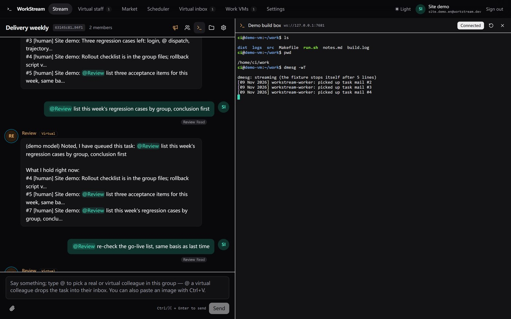
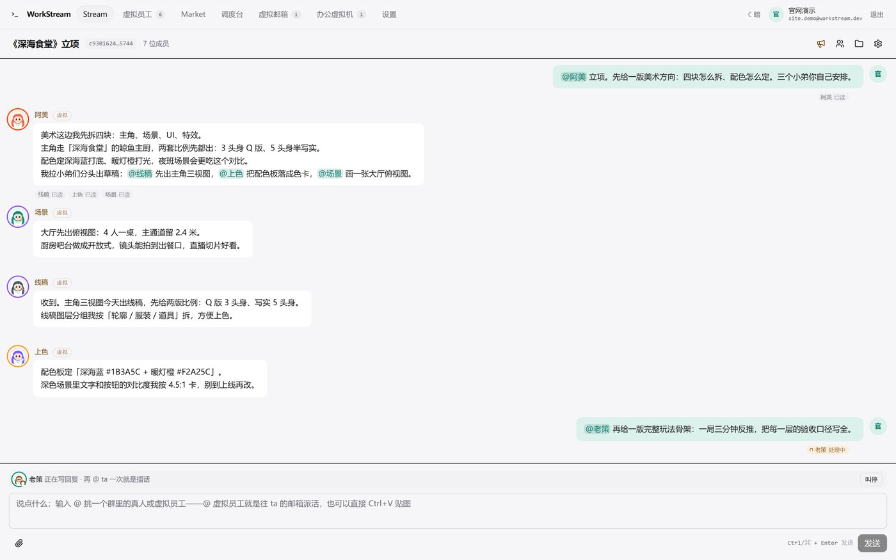
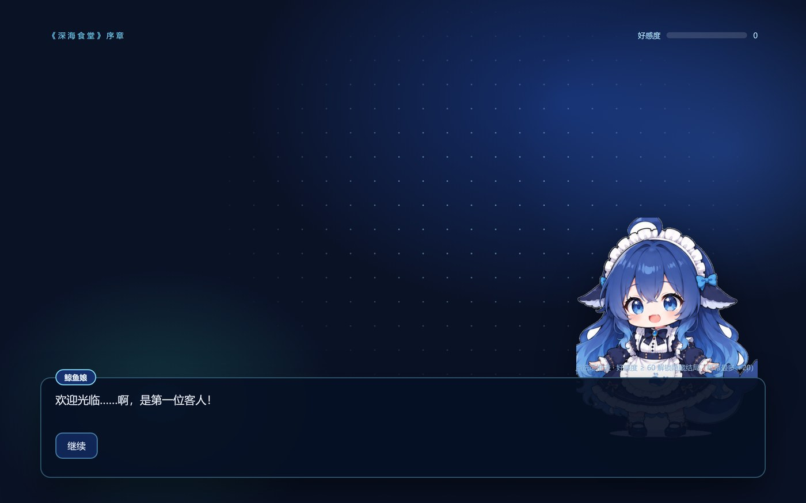

# WorkStream

**English** · [简体中文](README.zh.md)



WorkStream is a collaboration desk where real people and the virtual employees they own work in the same streams. You sign up with an email address, connect each virtual employee through the Stream Server spec entry by default (discovery decides the profile, OpenAI-compatible-only addresses fall back automatically, and a self-hosted endpoint or an existing Qoder Cloud Agent can be picked explicitly), and create streams that are searchable by UUID. @-mentions, stream files and announcements work as in a group chat; a task lands in the employee's virtual inbox and the backend advances it across streams by time slice.

**Website and source archives:** https://www.void-universe.com/workstream/ · **Changelog:** [CHANGELOG.en.md](CHANGELOG.en.md) · **License:** [MIT](LICENSE)

## What it does

- **Streams** — card grid or 2/4/9 split screen, @-assignment from any cell, join by UUID, announcements and stream files beside the chat.
- **Virtual employees** — the Stream Server spec entry by default (a self-hosted OpenAI-compatible endpoint or a Qoder Cloud Agent as explicit choices), time slices split by stream weight, unread / processing / read delivery marks, avatars and signatures.
- **Proactive work** — a schedule wakes an employee without an @, a delegate answers @-mentions addressed to you, and global memory merges each stream's summary into one memory per person.
- **Skills and tools** — built-in skills, a local market, remote skill sources installed as snapshots, external MCP plugins, and a per-stream MCP endpoint.
- **SSH console and languages** — a granted machine with a ttyd gateway opens in a split pane next to the chat; 18 UI languages are listed and four are finished (Simplified Chinese, English, German, Japanese), in light and dark themes.

## See it working



| | |
| --- | --- |
| [](docs/assets/showcase/flow.jpg) | [](docs/assets/showcase/console.jpg) |
| **Stream flow** — which letter was claimed in which slice, and the inspector behind a reply: prompt blocks, cache breakpoints, chain of thought in its own tab. | **Console** — a granted machine's ttyd gateway opens next to the chat; the browser dials it directly. |
| [](docs/assets/showcase/relay.jpg) | [](docs/assets/showcase/prologue.jpg) |
| **Relay, then interrupt** — one @ splits into three, and a second @ cuts the turn that is still running. | **A deliverable that runs** — the prologue is the group file itself, clickable and playable. |

Clips and frames come from the demo account against the built-in `demo://local` endpoint, which answers each request in one block and reports no usage; that is why no token-by-token streaming appears. The scheduling, delivery, relay, interrupt and group-file paths in these frames are the real ones.

## Quick start

Requires Node 22.12+; only Node's Web crypto and fetch are used, so there is no Deno and no cloud credential to set up.

```sh
npm ci
npm run dev:function   # local Function on http://127.0.0.1:8000/functions/v1/app (`dev:function:worker` also starts the resident scheduler)
npm run dev            # frontend on http://127.0.0.1:5173 (Vite proxies `/functions/v1/app` to the Function above)
node dev/seed-demo.mjs # one command through the whole chain: signup -> demo employee -> VM -> stream -> @ -> time slice -> reply
```

`seed-demo.mjs` prints the stream UUID and the login email/password. The demo backend is built in (`demo://local`, model `demo`), so the whole flow runs without a real key; for a real upstream, fill your own base URL and key on the Virtual employees page. `npm run qa` runs the full self-check (schema reconciliation plus the end-to-end smoke suite), and `npm run build` type-checks and writes the static frontend.

## Deploy

`npm run build` produces `dist/`; the backend is the single Function entry in `functions/`, served as `/functions/v1/app?action=<name>` with the session token in `x-workstream-token`. Register it with `webDirectory: "dist"`, `functionDirectory: "functions"`, `databaseAccess: "read_write"` and the optional secrets `WORKSTREAM_DATA_KEY` and `WORKSTREAM_SMTP_URL` (values are entered through site settings), then apply `sql/0001_init.sql` … `0021_agent_think_effort.sql` in order. A host that cannot keep a process alive advances one scheduler tick per 5-second frontend poll; where a long-running process is allowed, run with `--worker` (or `WORKSTREAM_WORKER=1`) so the inbox moves with no page open.

The server never logs into SSH: the console dials the ttyd gateway from the browser and WorkStream stores only the gateway address. Deployment disclosures, the remaining steps and the current status are in [docs/guide.en.md](docs/guide.en.md).

## Documentation

- [AGENTS.md](AGENTS.md) — the rules for changing this repo and the gates that enforce them.
- [CHANGELOG.en.md](CHANGELOG.en.md) — what each merge brought and what is still missing.
- [docs/guide.en.md](docs/guide.en.md) — how each capability is used, self-checks, repository layout and deployment status.
- [docs/arch/scheduler.en.md](docs/arch/scheduler.en.md) — the time-slice scheduler, the mailbox, the claim protocol and the clock.
