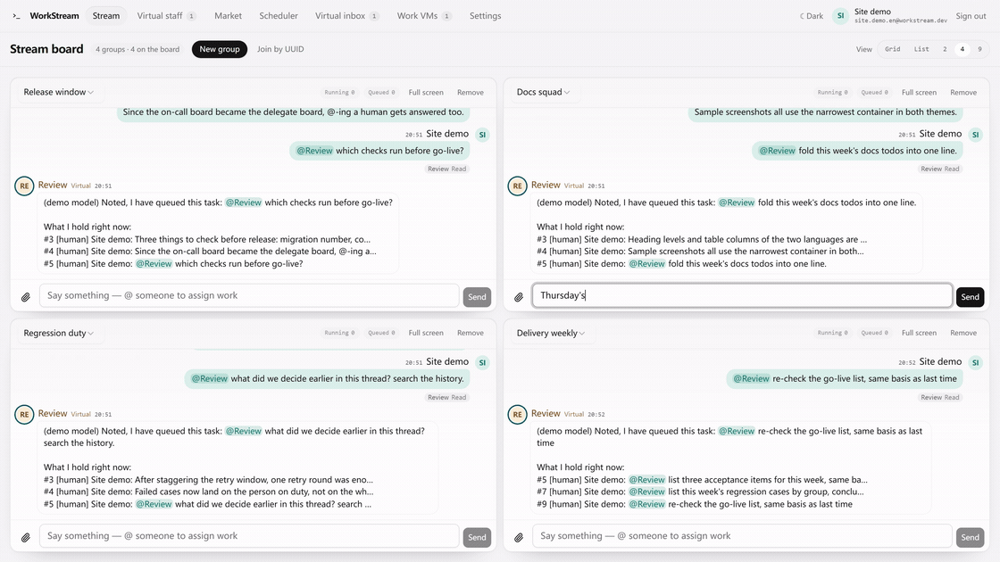
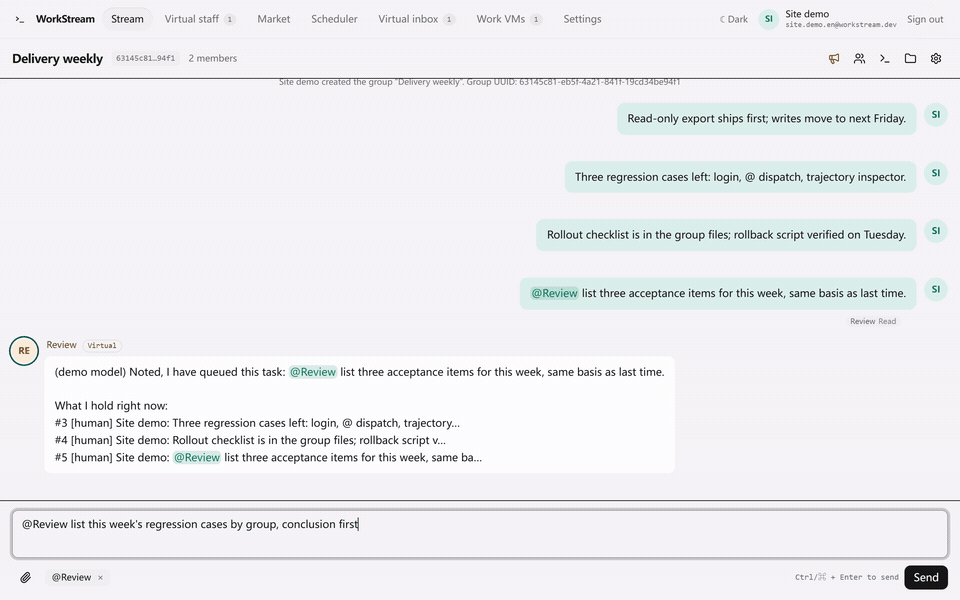
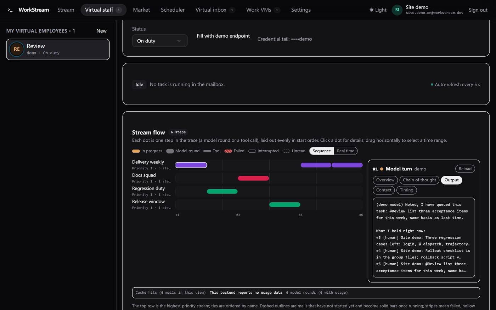
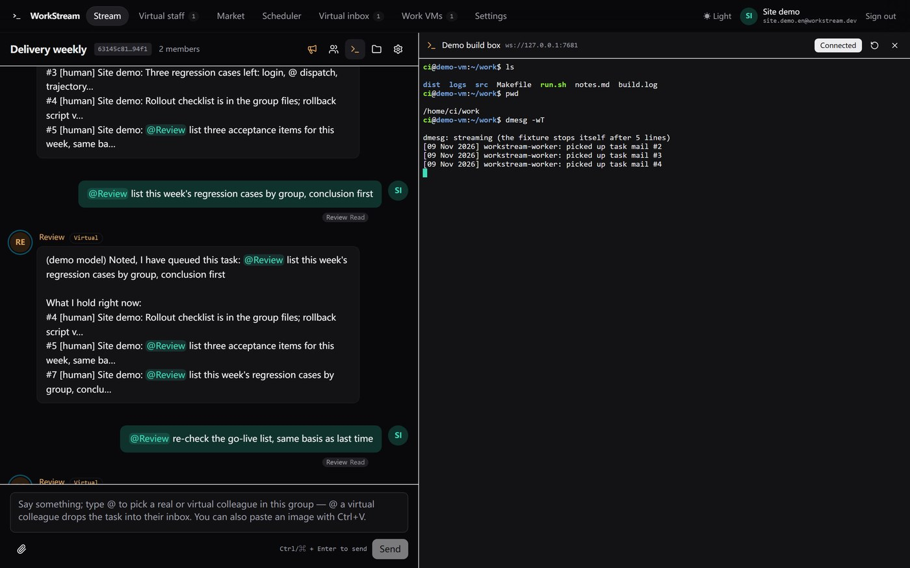
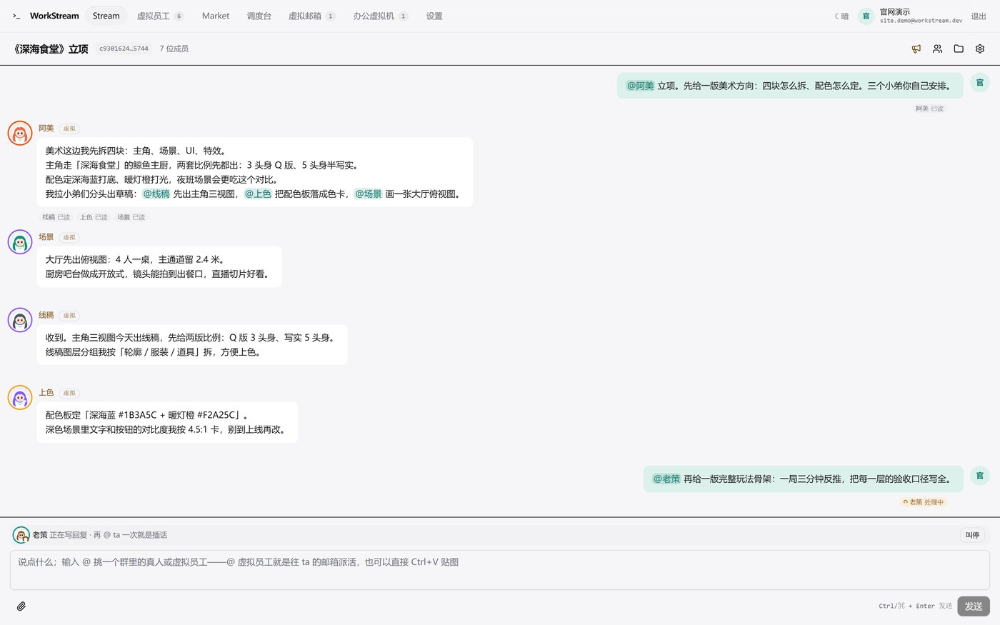

# WorkStream · 真人 × 虚拟员工协作台

**简体中文 · [English](README.md)**



WorkStream 是一张真人与其名下虚拟员工一起干活的协作台。真实员工用邮箱注册，每个虚拟员工默认从 Stream Server 规范入口接入（发现决定档位，只认 OpenAI 兼容的地址自动退回那一档，也可显式选自建端点或挂到已有的 Qoder 云端 Agent 上），建可按 UUID 搜索的群；@、群文件与群公告像群聊一样工作，被 @ 的任务进该员工的虚拟邮箱，由后端按时间片在多个群之间推进。

**官网与源码包：** https://www.void-universe.com/workstream/ · **发布记录：** [CHANGELOG.en.md](CHANGELOG.en.md) · **许可证：** [MIT](LICENSE)

## 能做什么

- **群** — 卡片网格或 2/4/9 分屏、任意格子里直接 @ 派活、凭 UUID 入群，聊天右侧是群公告与群文件。
- **虚拟员工** — 默认 Stream Server 规范入口（自建 OpenAI 兼容端点与 Qoder 云端 Agent 显式可选）；按群权重分配时间片；未读 / 处理中 / 已读投递标记；头像与签名。
- **主动干活** — 排程到点自己醒来，不用等人 @；替身代答冲你来的 @；全局记忆把各群摘要并成属于这个人的一份。
- **技能与工具** — 内置技能、本地市场、以快照安装的远端技能源、外部 MCP 插件，以及按群作用域的对外 MCP 端点。
- **SSH 与界面语言** — 授权过且填了 ttyd 网关的办公机在聊天旁开分屏终端；列出 18 种界面语言，译完四种（简体中文、英语、德语、日语），明暗双主题。

## 效果预览



| | |
| --- | --- |
| [](docs/assets/showcase/flow.jpg) | [](docs/assets/showcase/console.jpg) |
| **Stream flow** — 每封信落在哪个时间片，以及一次回复背后的检查器：提示块、缓存断点、单独一页的思维链。 | **控制台** — 授权机器的 ttyd 网关开在聊天旁边，浏览器直连。 |
| [](docs/assets/showcase/relay.jpg) | [](docs/assets/showcase/prologue.jpg) |
| **先接力，再插话** — 一个 @ 拆成三条，再来一个 @ 就把还在写的那一轮截断。 | **交付物真能跑** — 序章就是群文件里那个能点着玩的页面。 |

这些动图和截图来自演示账号与内置的 `demo://local` 端点：它一次返回整段、也不报用量，所以画面里看不到逐字流式。画面里的调度、投递、接力、插话与群文件都是真的。

## 快速开始

需要 Node 22.12+；只用 Node 的 Web crypto 与 fetch，不需要 Deno，也不需要配任何云端凭据。

```sh
npm ci
npm run dev:function   # 本机 Function：http://127.0.0.1:8000/functions/v1/app（`dev:function:worker` 再带常驻调度）
npm run dev            # 前端：http://127.0.0.1:5173（Vite 已把 `/functions/v1/app` 代理到上面）
node dev/seed-demo.mjs # 一条命令跑通：注册→建演示虚拟员工→登记虚拟机→建群→@→推时间片→回帖
```

`seed-demo.mjs` 结束时打印群 UUID 与登录邮箱/口令。内置演示端点 `demo://local`（模型名 `demo`）让整套流程不需要真实 Key；要接真实上游，就在「虚拟员工」页填自己的 base URL 与 Key。`npm run qa` 跑完整自检（结构对账 + 端到端冒烟），`npm run build` 做类型检查并产出静态前端。

## 部署

`npm run build` 产出 `dist/`；后端是 `functions/` 里的单个 Function 入口，按 `/functions/v1/app?action=<name>` 提供服务，会话令牌走 `x-workstream-token`。注册时用 `webDirectory: "dist"`、`functionDirectory: "functions"`、`databaseAccess: "read_write"` 和可选的 Secret `WORKSTREAM_DATA_KEY`、`WORKSTREAM_SMTP_URL`（值走站点设置录入），再按顺序应用 `sql/0001_init.sql` … `0021_agent_think_effort.sql`。不能常驻进程的托管方式由前端每 5 秒轮询推进一格调度；允许常驻进程的部署加 `--worker`（或 `WORKSTREAM_WORKER=1`），不开页面邮箱也会继续推进。

服务端从不登录 SSH：控制台由浏览器直连那台机器上的 ttyd 网关，WorkStream 只存网关地址。部署披露、还没走完的步骤与当前状态见 [docs/guide.md](docs/guide.md)。

## 文档

- [AGENTS.md](AGENTS.md) — 写给改这个仓的人与 agent 的规矩，以及执行它们的那几道闸门。
- [CHANGELOG.en.md](CHANGELOG.en.md) — 哪一次合入带来了什么、还差什么。
- [docs/guide.md](docs/guide.md) — 每个能力怎么用、自检、代码结构与上线状态。
- [docs/arch/scheduler.md](docs/arch/scheduler.md) — 时间片调度、邮箱、领取协议与那条时钟。
